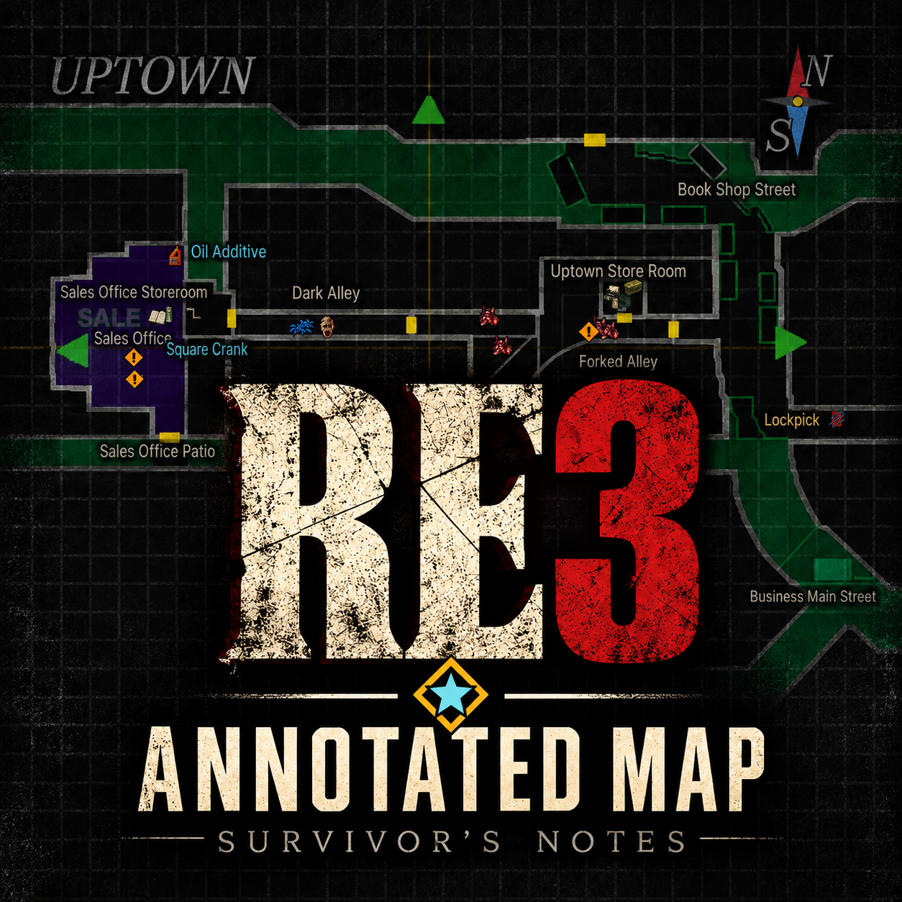
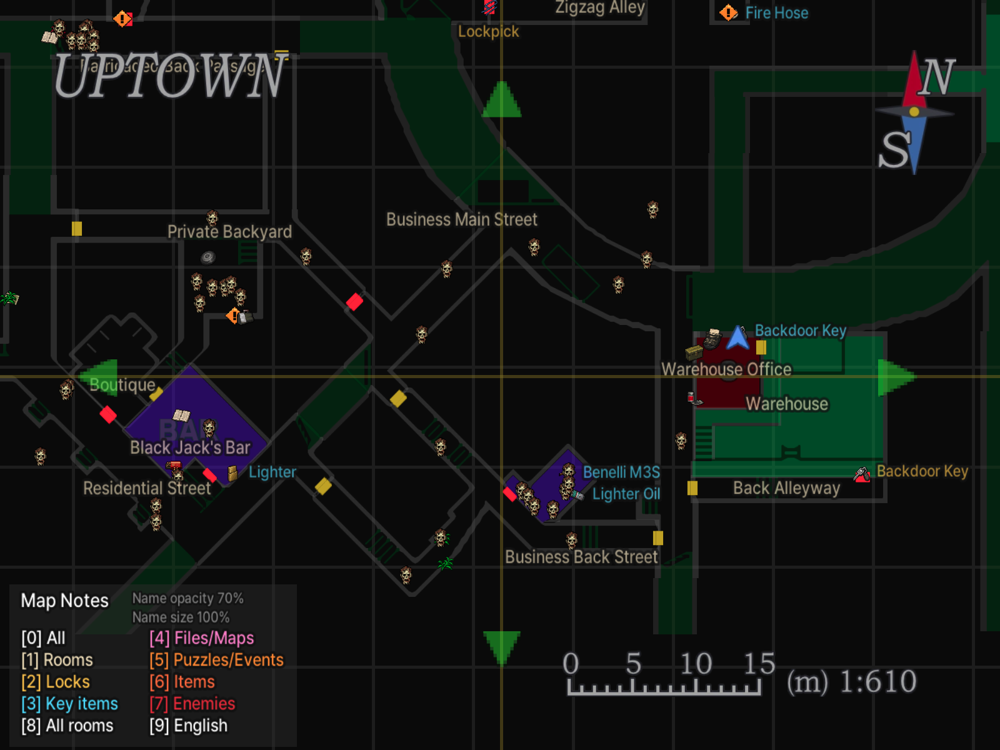
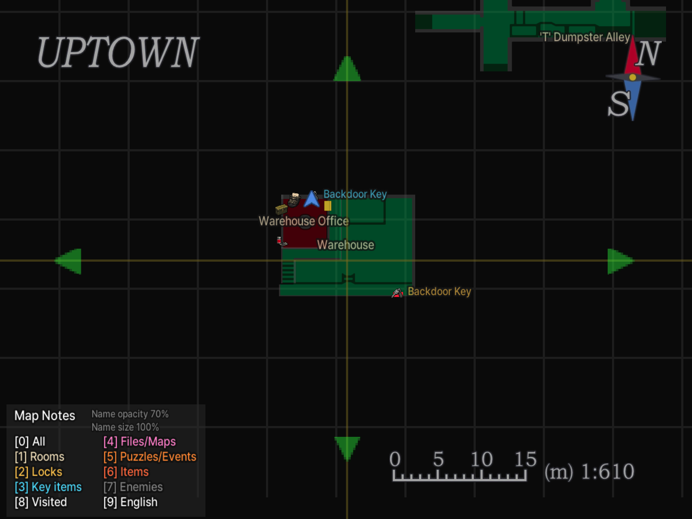
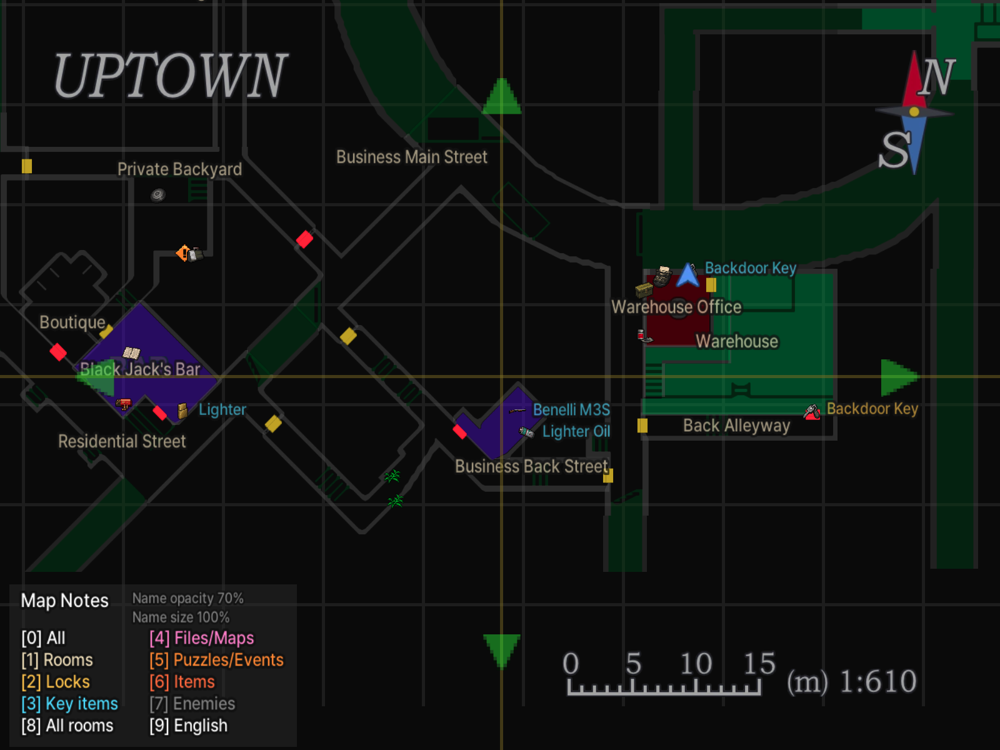
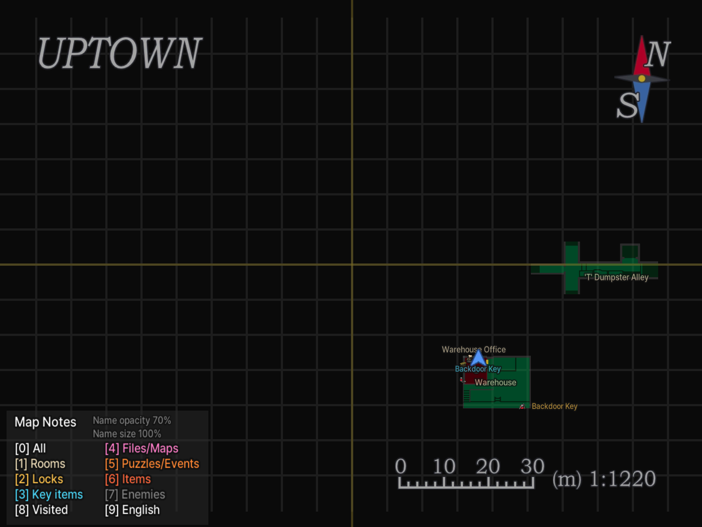
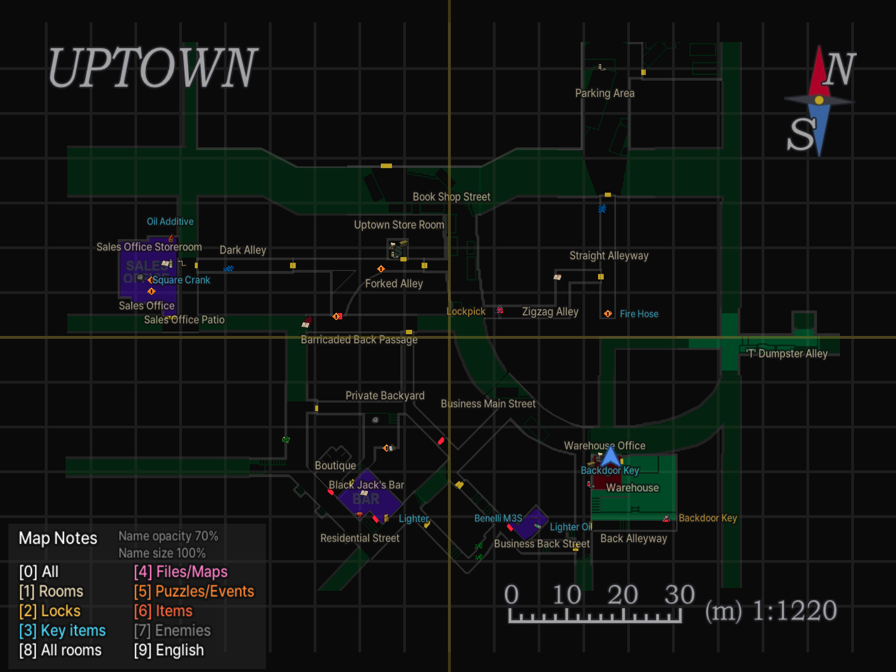
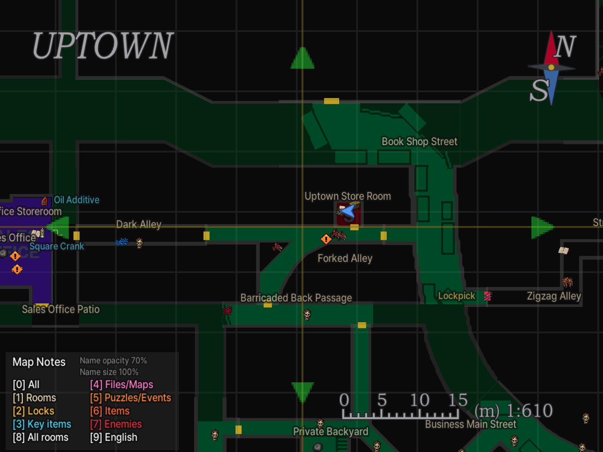
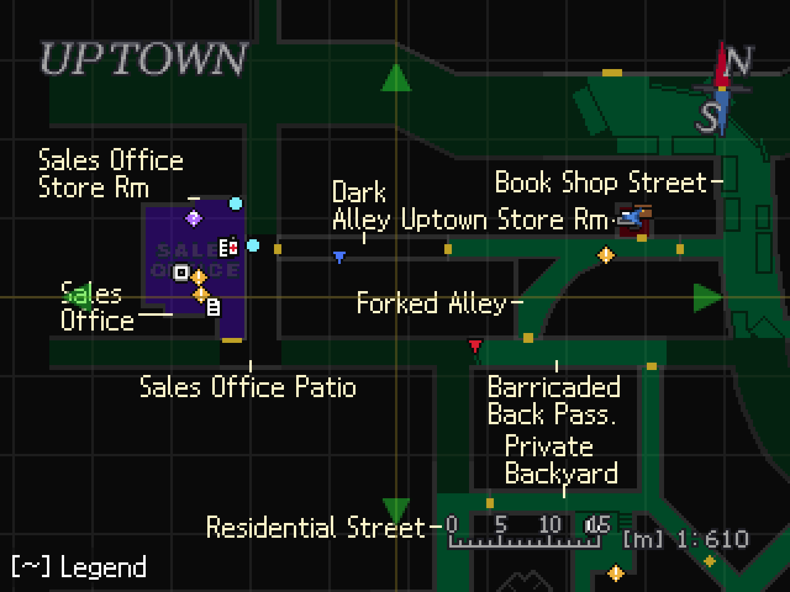
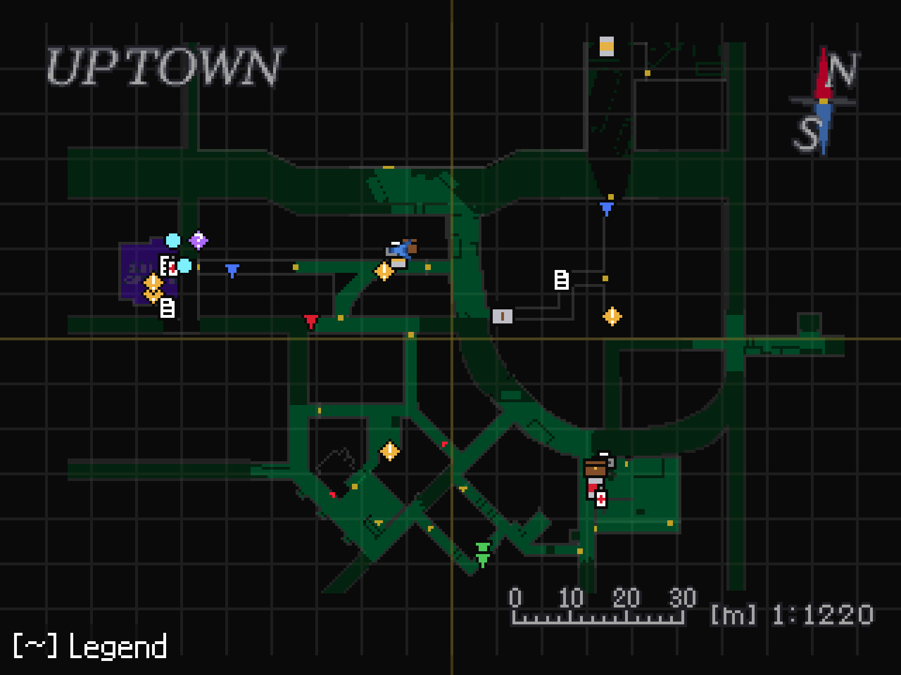

# RE3 Annotated Map - Survivor's Notes — Resident Evil 3 (1999)

[English](README.md) | 한국어

<p align="center"></p>

**상세 지도: 생존자의 메모** — 원작 Resident Evil 3 PC판(SourceNext `BIOHAZARD(R) 3 PC.exe` + Classic REbirth 1.0.3)의 지도에 방 이름, 잠긴 문과 열쇠, 아이템, 문서·지도, 퍼즐·Live Selection, 타자기·아이템 상자, 몬스터를 표시하는 ASI 모드입니다. 한국어/영어를 지원합니다. RE3 리메이크(2020)용이 아닙니다.

- 게임 자체의 지도 화면에 표시합니다. 주운 아이템, 열린 문, 완료한 퍼즐과 쓰러뜨린 몬스터는 지도에서 사라집니다.
- 방문한 방만 보거나, 지역 지도로 공개된 방 또는 모든 방을 볼 수 있습니다.
- 아이템·시설·몬스터를 픽셀 아이콘으로 표시합니다.

## 스크린샷



| | 방문한 방 | 모든 방 |
|---|---|---|
| 확대 |  |  |
| 축소 |  |  |



SD 모드(HD 텍스처 없이 Classic REbirth 사용):

| 확대 | 축소(방 이름 없음) |
|---|---|
|  |  |

## 표시 범위와 기본값

새 설정은 **영어, 이름 크기 100%, 이름 불투명도 70%, 아이콘 크기·불투명도 100%, 방문한 방만 표시, 방 이름만 켬, 아이템 이름 숨김**으로 시작합니다. `\`(한국 키보드에서는 `₩`) 키로 한국어로 바꾸고, `2`–`8`로 다른 항목을 켭니다. `9`로 범위를 바꿉니다. **모든 방**은 미방문 구역과 아이템을 미리 보여주므로 스포일러가 포함됩니다.

## HD와 SD

게임을 시작할 때 Classic REbirth `config.ini`의 `HDTextures` 설정을 따릅니다.

- **HD** (`HDTextures = 1`): `hires\misc\`의 `.webp` 파일로 글자와 아이콘을 선명하게 표시합니다.
- **SD** (`HDTextures = 0`이거나 항목이 없을 때): 저해상도용 1배 픽셀 마커와 픽셀 글꼴(Galmuri9)로 표시합니다. 방 이름은 짧은 선으로 방 옆에 붙고, 지도를 축소하면 숨겨집니다. SD에서는 이름·아이콘 크기, 불투명도, 아이템 이름을 쓸 수 없습니다.

## 설치

1. **Classic REbirth**(바이오하자드 3용, 1.0.3에서 확인)를 먼저 설치합니다. [공식 다운로드](https://classicrebirth.com/index.php/downloads/resident-evil-3-classic-rebirth/)
2. 게임을 종료하고 [Releases](https://github.com/eggu/resident-evil-3-annotated-map/releases/latest)에서 `RE3-Annotated-Map-<버전>.zip`을 받아 압축을 풉니다. `Source code`는 설치 파일이 아닙니다.
3. ZIP의 내용(`dsound.dll`, `RE3.AnnotatedMap.asi`, `hires`, `scripts`)을 `BIOHAZARD(R) 3 PC.exe`가 있는 게임 폴더에 폴더 구조 그대로 복사합니다. ASI 로더인 [Ultimate ASI Loader](https://github.com/ThirteenAG/Ultimate-ASI-Loader) v9.7.4(MIT)가 `dsound.dll`로 포함되어 있습니다. 기존 `hires` 폴더가 있으면 합치고, 같은 이름의 파일은 교체합니다. 다른 HD 모드를 사용한다면 먼저 기존 `hires` 폴더를 백업하세요. 기본 설정 파일 `RE3.AnnotatedMap.ini`는 게임 폴더에 아직 없을 때만 복사하세요. 이미 있으면 덮어쓰지 마세요(내 설정이 사라집니다).
   - 한글 패치 등으로 Ultimate ASI Loader가 이미 `dsound.dll`로 설치되어 있으면 기존 것을 그대로 두고 `dsound.dll`은 건너뛰세요.
   - ASI 로더가 아닌 다른 `dsound.dll`(예: DSOAL)이 있으면 덮어쓰지 말고, 포함된 `dsound.dll`을 `winmm.dll` 이름으로 복사하세요.
4. Classic REbirth로 게임을 실행하고 지도를 열면 표시됩니다. 한글 번역 모드는 필수가 아닙니다.

```text
게임 폴더/
├─ BIOHAZARD(R) 3 PC.exe
├─ dsound.dll   (Ultimate ASI Loader, 이미 있으면 건너뜀)
├─ RE3.AnnotatedMap.asi
├─ RE3.AnnotatedMap.ini   (기본 설정, 이미 있으면 덮어쓰지 않음)
├─ scripts/
│  └─ UltimateASILoader-LICENSE.txt
└─ hires/
   └─ misc/
      └─ 지도 모드의 .webp 파일들
```

업그레이드할 때는 기존 `RE3.AnnotatedMap.ini`를 지우거나 ZIP의 기본 파일로 덮어쓰지 마세요. 지도 표시 설정이 들어 있습니다.

제거: `RE3.AnnotatedMap.asi`, `.ini`, `.log`, `scripts/UltimateASILoader-LICENSE.txt`(다른 ASI 모드가 없으면 `dsound.dll`도)와 지도 모드 ZIP에 포함된 `.webp` 파일만 지우세요. 기존 HD 파일을 백업했다면 복원합니다. `hires` 폴더 전체를 지우면 다른 HD 모드도 영향을 받습니다.

## 문제 해결

- **지도가 전혀 나오지 않을 때**: 이 모드는 SourceNext `BIOHAZARD(R) 3 PC.exe`의 한 가지 빌드(실행 파일 시간표시 `0x44642AAC`, 이미지 크기 `0xB01000`)에서만 동작합니다. 다른 빌드에서는 아무것도 그리지 않고 `RE3.AnnotatedMap.log`에 `Unsupported executable`을 남깁니다. 또 Classic REbirth 1.0.3의 `ddraw.dll`에는 ASI 로더가 들어 있지 않아, ZIP에 Ultimate ASI Loader를 `dsound.dll`로 포함했습니다. `dsound.dll`이 `BIOHAZARD(R) 3 PC.exe`와 같은 폴더에 있는지, 다른 `dsound.dll`로 바뀌지 않았는지 확인하세요.
- **`HDTextures = 1`인데 지도 글자·아이콘이 흐릿할 때**: 선명한 글자는 REbirth가 `hires\misc\`의 `.webp` 파일을 읽어야 나옵니다. `hires\misc\`에 이 모드의 `.webp` 파일이 들어 있는지(`.asi`만 복사하면 흐릿합니다), REbirth 설정에서 저해상도·레트로 모드가 꺼져 있는지 확인하세요. `HDTextures = 0`이면 SD용 픽셀 마커와 글꼴로 표시됩니다.

## 단축키

지도 화면에서만 작동하며, 현재 상태가 범례에 표시됩니다.

| 키 | 동작 |
|---|---|
| 0 | 전체 표시 켜기/끄기 |
| 1 | 방 이름·타자기·아이템 상자 |
| 2 | 잠긴 문·필요한 열쇠 |
| 3 | 핵심 아이템 |
| 4 | 문서·지도 |
| 5 | 퍼즐(아이템이나 풀이가 필요한 장치) |
| 6 | 이벤트(스포일러가 되는 장면, Live Selection) |
| 7 | 일반 아이템(탄약·회복·리본·화약) |
| 8 | 적 |
| 9 | 방문한 방 → 공개된 방(지역 지도 획득) → 모든 방 |
| \\(₩) | 한국어 / English |
| - · = (+), 숫자패드 - · + | 이름 크기 10%씩(50–200%) |
| [ · ] | 이름 불투명도 10%씩(10–100%) |
| Shift + - · = (+) | 아이콘 크기 10%씩(50–200%) |
| Shift + [ · ] | 아이콘 불투명도 10%씩(10–100%) |
| H | 아이템 이름 3단계 전환: 모두 표시 → 일반 아이템 제외 → 모두 숨김(열쇠·잠긴 문·문서·퍼즐·일반 아이템) |
| ~ | 범례와 범례 오른쪽의 크기·불투명도 수치 접기/펴기 |

## 설정

지도 화면에서 바꾼 설정은 자동으로 저장됩니다. 설정 파일은 게임 폴더의 `RE3.AnnotatedMap.ini`입니다. 직접 편집하려면 게임을 종료한 뒤 메모장으로 여세요. 설정 파일에서만 바꿀 수 있는 항목:

- `Modifier=Shift`: 아이콘 크기·불투명도에 함께 누르는 키. `Ctrl`로 바꿀 수 있습니다.
- `LockMarker=Door`: 잠긴 문 아이콘을 문 위치에 표시합니다. `Unvisited`로 바꾸면 문 너머 방(그 방만 방문했다면 문 이쪽)에 표시합니다.
- `DisplayMode=Auto`: `HDTextures`를 따릅니다(HD와 SD 참고). `HD`나 `SD`로 고정할 수 있습니다.

이전 버전에서 업그레이드하면 기존 설정은 유지되며 한 번 자동 변환됩니다. 이벤트는 예전 퍼즐 설정값으로 시작하고, 이름·아이템 아이콘 크기는 지금 보이는 크기가 유지됩니다. 열쇠·잠긴 문 이름은 꺼진 상태로 시작합니다(`H`로 켬). 이름 불투명도는 이제 `[` · `]`이고, Shift + `-` · `+`는 아이콘 크기입니다.

이름을 크게 하면 서로 겹칠 수 있습니다.

## 표시 안내

방 이름은 방 안의 정해진 자리에 표시되고, 너무 좁은 방은 짧은 선으로 이어진 바깥 자리에 표시됩니다. 아이콘과 아이템 이름이 방 이름을 가릴 수 있습니다. 퍼즐 표식은 필요한 아이템이 아니라 그 자리의 장치 이름(예: 책 받침대, 소화전)을 표시합니다. 같은 자리에 두 번 놓인 같은 아이템은 이름을 한 번만 표시합니다. 핵심 아이템·퍼즐 아이콘과 겹친 일반 아이템·적 아이콘은 숨기고, 범례·수치 패널 아래에 오는 표시는 그리지 않습니다.

주황색 `!`는 퍼즐, 보라색 `?`는 이벤트(Live Selection 선택 장면과 영상·긴 연출이 시작되는 자리)입니다. 이벤트는 스포일러가 될 수 있어 기본으로 꺼져 있고(`6`), 한 번 지나가면 사라집니다. 이벤트 표식에는 이름이 없고(`H`로도 나타나지 않음) 보라색 `?`만 표시됩니다. 이벤트 표시는 대략적인 위치를 안내하며, 선택 결과는 알려주지 않습니다. 게임 데이터에서 찾을 수 있는 장면만 표시하며(일부 장면은 한 번 봤는지 알 수 없어 제외), 방에 들어가면 자동으로 시작되는 장면은 방 대략 위치에 표시합니다.

몬스터 표시는 일부 출현을 빠뜨릴 수 있습니다. 네메시스의 예정 출현 위치는 일부만 표시하며, 네메시스가 떨어뜨리는 아이템은 표시하지 않습니다.

## 위키와 지원

[한국어 위키](docs/wiki/README.md) · [English wiki](docs/wiki/README.en.md): 방, 잠금·열쇠, 아이템, 퍼즐·이벤트, 문서·지도, 세이브 지점과 몬스터. 표에는 스포일러가 있습니다.

문제를 알릴 때는 어느 장소에서 어떤 표시가 잘못됐는지 스크린샷과 함께 설명해 주세요.

## 빌드

소스에서 직접 빌드하려면 [개발 안내](docs/DEVELOPMENT.md)를 참고하세요.

## 다른 지도 모드

- [RE1 Annotated Map - Survivor's Notes](https://github.com/eggu/resident-evil-annotated-map) — 바이오하자드 1 (1996)
- [RE2 Annotated Map - Survivor's Notes](https://github.com/eggu/resident-evil-2-annotated-map) — 바이오하자드 2 (1998)

## 크레딧과 권리

제작: **커트씨**. 비공식 팬 모드이며 Capcom 또는 Classic REbirth와 관련이 없습니다. 소스 코드는 [MIT 라이선스](LICENSE)입니다. 참고 자료와 글꼴 출처는 [NOTICE](NOTICE.md)에 있습니다.
