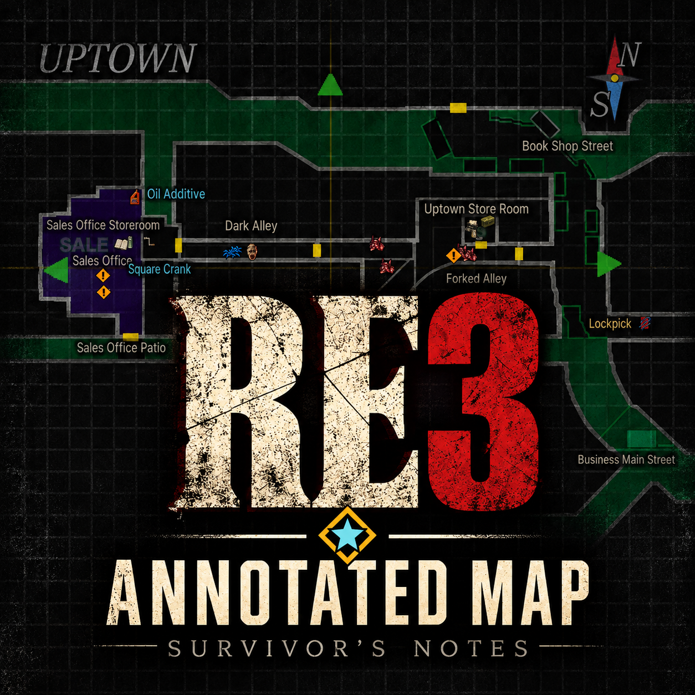
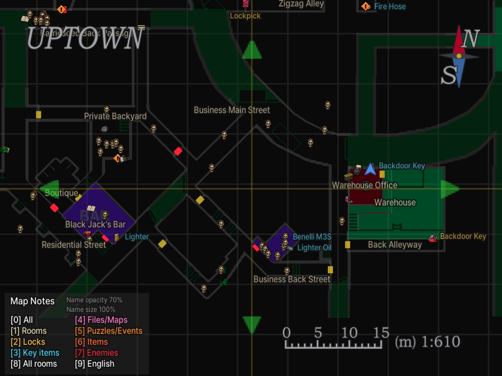
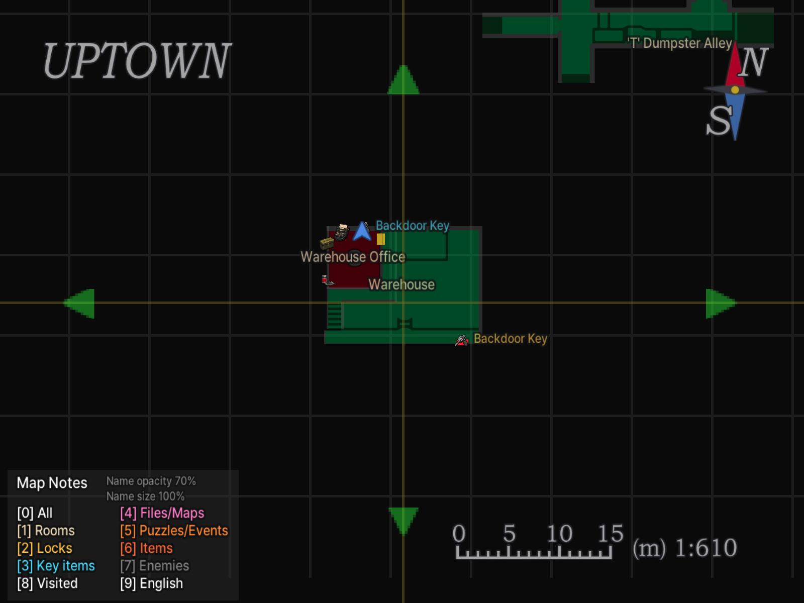
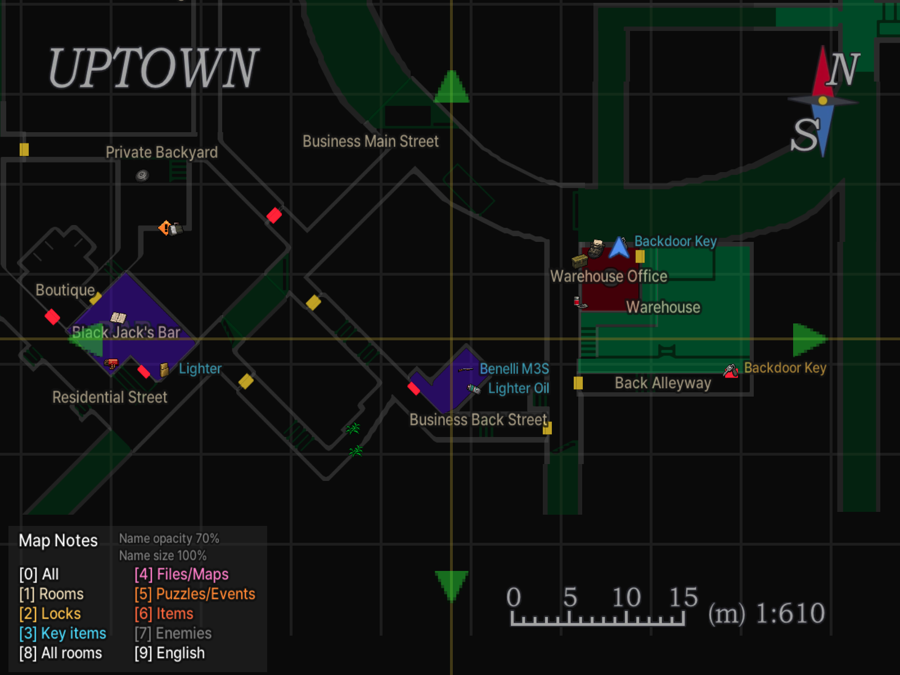
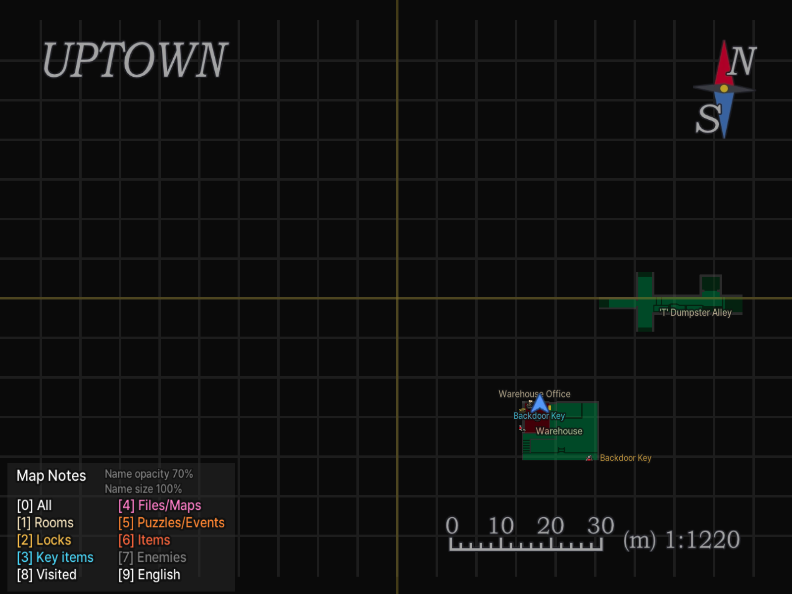
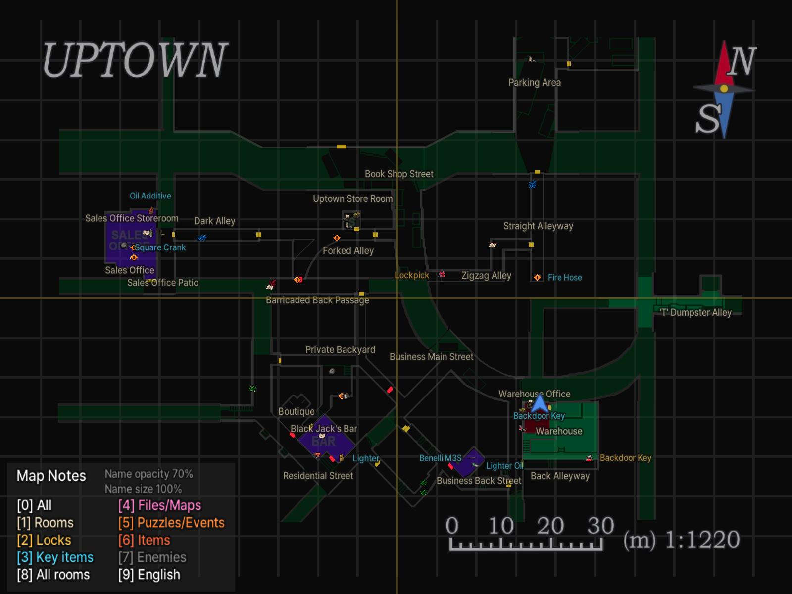
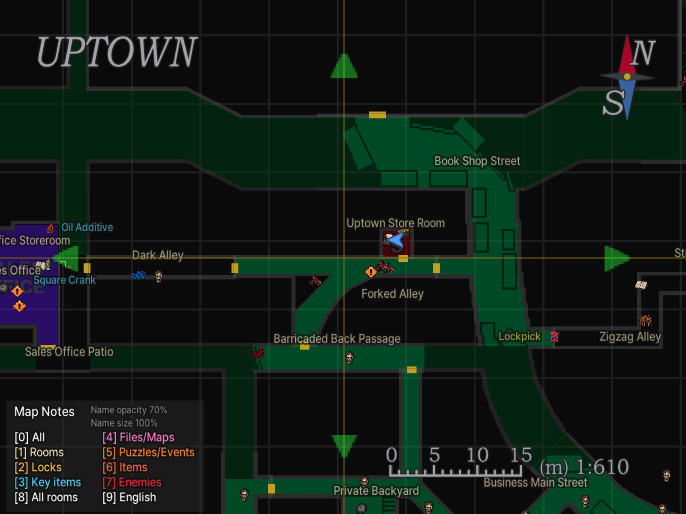

# RE3 Annotated Map - Survivor's Notes — Resident Evil 3 (1999)

English | [한국어](README.ko.md)

<p align="center"></p>

A Korean/English ASI map mod for the original Resident Evil 3 PC release (SourceNext `BIOHAZARD(R) 3 PC.exe` + Classic REbirth 1.0.3). Adds room names, locked doors and keys, items, documents/maps, puzzles/Live Selections, typewriters, item boxes and monsters to the game's map. Not for the 2020 remake.

- Annotations appear on the game's own map. Picked-up items, opened doors, completed puzzles and defeated monsters disappear from the map.
- Choose visited rooms, rooms revealed by an area map, or all rooms.
- Pixel icons represent items, facilities and monsters.

## Screenshots



| | Visited rooms | All rooms |
|---|---|---|
| Zoomed in |  |  |
| Zoomed out |  |  |



## Visibility and defaults

A new configuration starts in **English, name size 100%, name opacity 70%, icon size and opacity 100%, visited rooms only, with only Rooms on and item names hidden**. Press `\` (the `₩` key on Korean keyboards) for Korean and `2`–`8` to turn on other categories. Press `9` to change scope. **All rooms** reveals unexplored rooms and items and contains spoilers.

## Installation

1. Install **Classic REbirth** for Resident Evil 3 first (tested with 1.0.3). [Official download](https://classicrebirth.com/index.php/downloads/resident-evil-3-classic-rebirth/)
2. Close the game. Download `RE3-Annotated-Map-<version>.zip` from [Releases](https://github.com/eggu/resident-evil-3-annotated-map/releases/latest) and extract it. `Source code` is not the install package.
3. Copy the ZIP contents (`dsound.dll`, `RE3.AnnotatedMap.asi`, `hires`, `scripts`) into the game folder containing `BIOHAZARD(R) 3 PC.exe`, preserving the folder structure. [Ultimate ASI Loader](https://github.com/ThirteenAG/Ultimate-ASI-Loader) v9.7.4 (MIT) is included as `dsound.dll`. Merge with an existing `hires` folder and replace matching files. If you use another HD mod, back up your existing `hires` folder first. Copy the default settings file `RE3.AnnotatedMap.ini` only if the game folder does not have one yet. Never overwrite an existing one (it holds your settings).
   - If Ultimate ASI Loader is already installed as `dsound.dll` (e.g. by a translation patch), keep yours and skip `dsound.dll`.
   - If you have a different `dsound.dll` (e.g. DSOAL), do not overwrite it: copy the included one as `winmm.dll`.
4. Launch the game with Classic REbirth and open the map. The Korean translation mod is not required.

```text
game folder/
├─ BIOHAZARD(R) 3 PC.exe
├─ dsound.dll   (Ultimate ASI Loader; skip if you already have it)
├─ RE3.AnnotatedMap.asi
├─ RE3.AnnotatedMap.ini   (default settings; never overwrite an existing one)
├─ scripts/
│  └─ UltimateASILoader-LICENSE.txt
└─ hires/
   └─ misc/
      └─ the map mod's .webp files
```

When upgrading, keep your existing `RE3.AnnotatedMap.ini`: do not delete it or overwrite it with the default file from the ZIP. It holds your map settings.

Uninstall: remove `RE3.AnnotatedMap.asi`, `.ini`, `.log`, `scripts/UltimateASILoader-LICENSE.txt` (and `dsound.dll` if no other ASI mod uses it) and only the `.webp` files included in the map ZIP. Restore backed-up HD files if applicable. Do not delete the entire `hires` folder: other HD mods also use it.

## Troubleshooting

- **Nothing appears on the map**: the mod only runs on one build of the SourceNext `BIOHAZARD(R) 3 PC.exe` (PE timestamp `0x44642AAC`, image size `0xB01000`). On any other build it draws nothing and writes `Unsupported executable` to `RE3.AnnotatedMap.log`. Classic REbirth 1.0.3's `ddraw.dll` does not load `.asi` files, so the ZIP includes Ultimate ASI Loader as `dsound.dll`. Check that `dsound.dll` sits next to `BIOHAZARD(R) 3 PC.exe` and was not replaced by a different `dsound.dll`.
- **Map text or icons look blurry**: sharp text appears only when REbirth's HD texture feature reads the `.webp` files in `hires\misc\`. Without them the low-resolution text is simply scaled up. Check: (1) `config.ini` in the game folder has `HDTextures = 1` under `[DLL]` (with `HDTextures = 0` the map shows a large notice at the top left, `HD textures off: set HDTextures=1 in config.ini`, and `RE3.AnnotatedMap.log` gets a warning). (2) `hires\misc\` contains this mod's `.webp` files (copying only the `.asi` looks blurry). (3) REbirth's low-resolution and retro modes are off.

## Controls

Keys work on the map screen only. The legend shows the current state.

| Key | Action |
|---|---|
| 0 | All annotations on/off |
| 1 | Room names, typewriters and item boxes |
| 2 | Locked doors and required keys |
| 3 | Key items |
| 4 | Documents and maps |
| 5 | Puzzles (devices that need an item or a solution) |
| 6 | Events (story scenes that can spoil, Live Selections) |
| 7 | Common items (ammo, healing, ribbons, gunpowder) |
| 8 | Enemies |
| 9 | Visited → revealed by an area map → all rooms |
| \\(₩) | Korean / English |
| - · = (+), numpad - · + | Name size in 10% steps (50–200%) |
| [ · ] | Name opacity in 10% steps (10–100%) |
| Shift + - · = (+) | Icon size in 10% steps (50–200%) |
| Shift + [ · ] | Icon opacity in 10% steps (10–100%) |
| H | Item names, 3 states per press: all → all except common items → hidden (keys, locked doors, documents, puzzles, common items) |
| ~ | Fold or unfold the legend and the size and opacity readouts beside it |

## Settings

Changes made on the map are saved automatically to `RE3.AnnotatedMap.ini` in the game folder. Close the game before opening it in Notepad to edit it manually. Options available only in the file:

- `Modifier=Shift`: the key held for icon size and opacity. It can be `Ctrl`.
- `LockMarker=Door`: locked-door icons sit on the door. With `Unvisited` they sit in the room beyond the door (or on this side if only that room was visited).

When upgrading from an earlier version, your settings are kept and converted once: Events starts with your old Puzzles setting, and name and item-icon sizes keep the size you had. Key and locked-door names start off (press `H`). Name opacity is now `[` · `]`; Shift + `-` · `+` changes icon size.

Enlarged names may overlap.

## Marker guide

Room names sit at a fixed spot inside their room; a room too narrow for its name gets a short line to a spot outside. Icons and item names may cover room names. Puzzle markers show the name of the device (for example Book Stand, Fire Hydrant), not the item it needs. The same item listed twice at one spot is named once. Common item and enemy icons that fall on a key item or puzzle icon are hidden, and nothing is drawn under the legend or the readouts.

Orange `!` marks puzzles; purple `?` marks events (Live Selection scenes and the spots where a movie or long cutscene starts). Events can spoil the story, so they start off (`6`) and disappear once you have passed them. Event markers have no name (the `H` toggle does not add one), only the purple `?`. Event markers show approximate locations, not choice outcomes. Only scenes that can be found in the game data are marked (some scenes are left out because the game gives no way to tell whether you have seen them); scenes that start by themselves when you enter a room are marked at the room's approximate centre.

Some monster encounters may be missing. Only some upcoming Nemesis appearances are shown. Items dropped by Nemesis are not shown.

## Wiki and support

[English wiki](docs/wiki/README.en.md) · [한국어 위키](docs/wiki/README.md): rooms, locks/keys, items, puzzles/events, documents/maps, save points and monsters. Tables contain spoilers.

When reporting an issue, describe the location and what is missing or incorrect, with a screenshot.

## Build

To build from source, see the [development guide](docs/DEVELOPMENT.md).

## Other map mods

- [RE1 Annotated Map - Survivor's Notes](https://github.com/eggu/resident-evil-annotated-map) — Resident Evil (1996)
- [RE2 Annotated Map - Survivor's Notes](https://github.com/eggu/resident-evil-2-annotated-map) — Resident Evil 2 (1998)

## Credits and rights

Created by **커트씨**. An unofficial fan mod, unaffiliated with Capcom or Classic REbirth. Source code is under the [MIT License](LICENSE). References and font credits are listed in [NOTICE](NOTICE.md).
