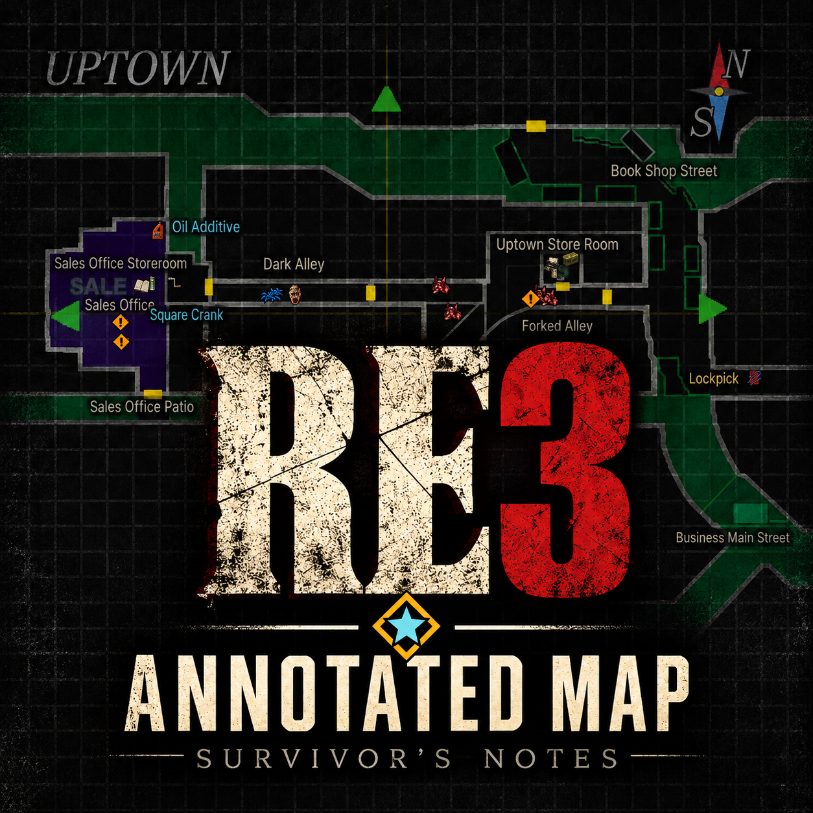
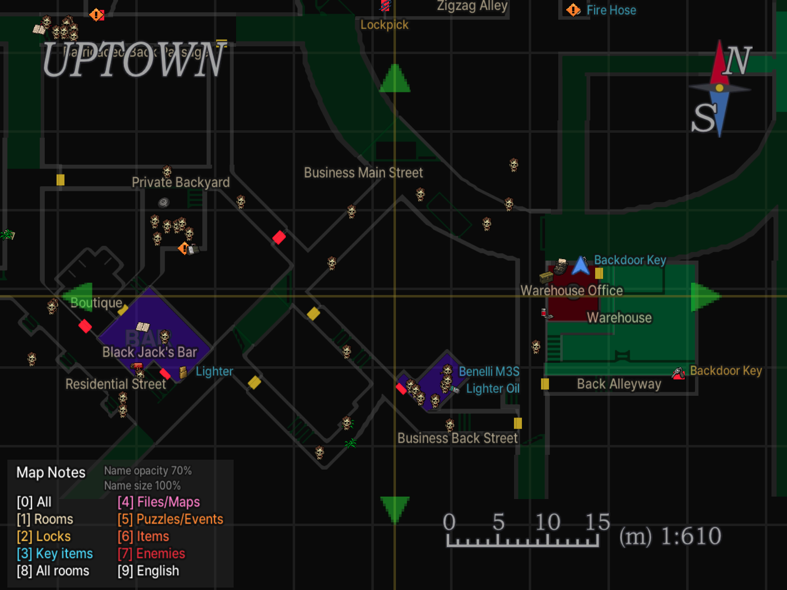
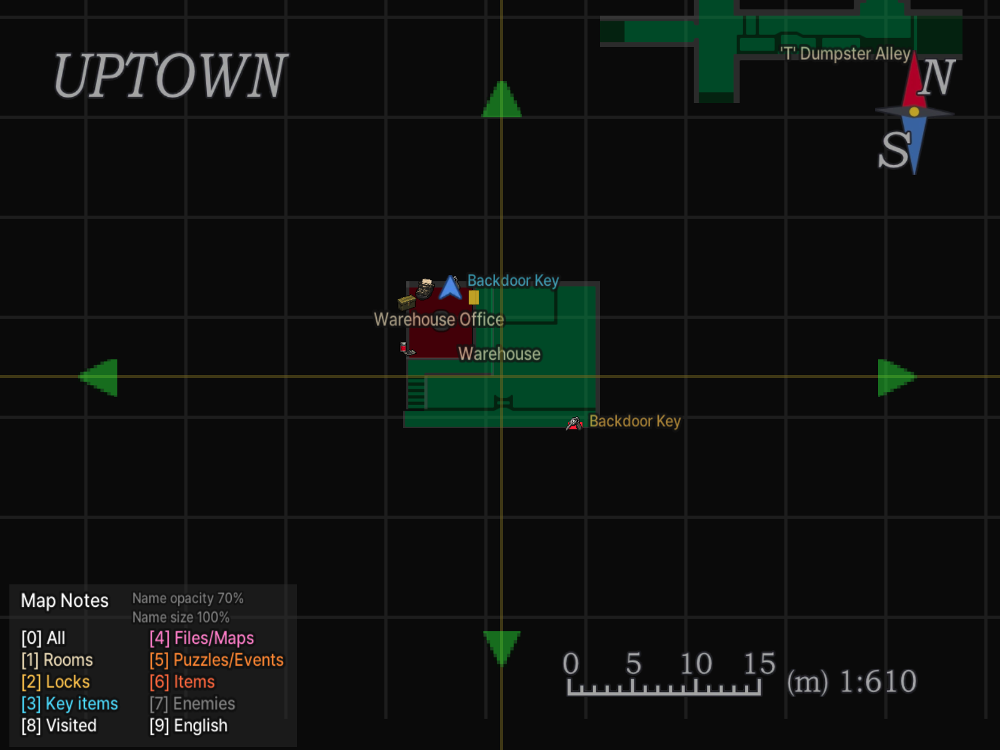
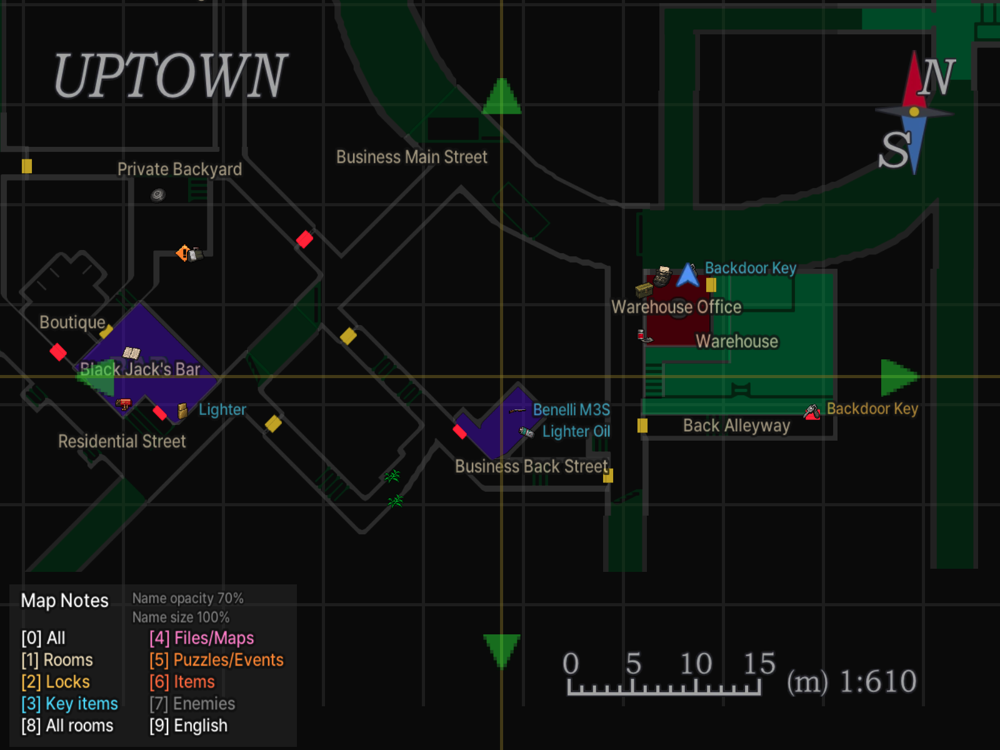
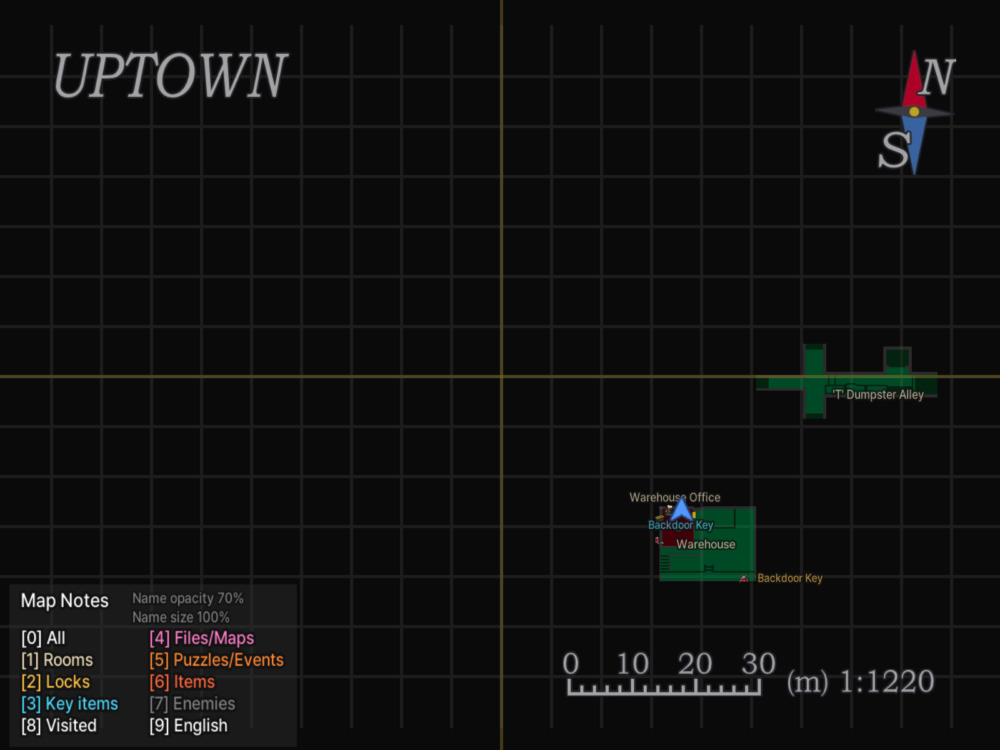
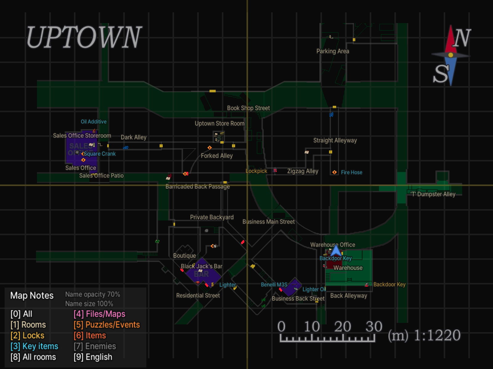
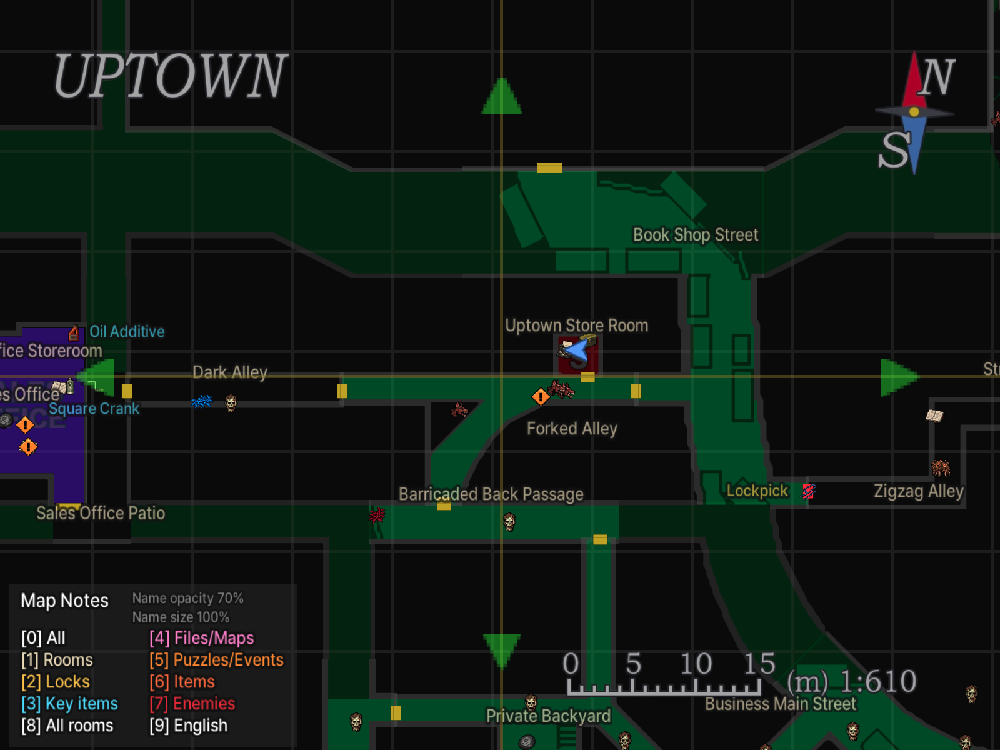

# RE3 Annotated Map - Survivor's Notes — Resident Evil 3 (1999)

[English](README.en.md) | 한국어

<p align="center"></p>

**상세 지도: 생존자의 메모** — 원작 Resident Evil 3 PC판(SourceNext `BIOHAZARD(R) 3 PC.exe` + Classic REbirth 1.0.3)의 지도에 방 이름, 잠긴 문과 열쇠, 아이템, 문서·지도, 퍼즐·Live Selection, 타자기·아이템 상자, 몬스터를 표시하는 ASI 모드입니다. 한국어/영어를 지원합니다. RE3 리메이크(2020)용이 아닙니다.

- 게임 자체의 지도 화면에 표시합니다. 주운 아이템, 열린 문, 완료한 퍼즐과 쓰러뜨린 몬스터는 지도에서 사라집니다.
- 방문한 방만 보거나, 지역 지도로 공개된 방 또는 모든 방을 볼 수 있습니다.
- 아이템·시설·몬스터를 픽셀 아이콘으로 표시합니다.

## 스크린샷



| | 방문한 방 | 모든 방 |
|---|---|---|
| 확대 |  |  |
| 축소 |  |  |



## 표시 범위와 기본값

새 설정은 **영어, 이름 크기 100%, 불투명도 70%, 방문한 방만 표시, 방 이름만 켬**으로 시작합니다. `9`로 한국어로 바꾸고, `2`–`7`로 다른 항목을 켭니다. `8`로 범위를 바꿉니다. **모든 방**은 미방문 구역과 아이템을 미리 보여주므로 스포일러가 포함됩니다.

## 설치

1. **Classic REbirth**(바이오하자드 3용, 1.0.3에서 확인)를 먼저 설치합니다. [공식 다운로드](https://classicrebirth.com/index.php/downloads/resident-evil-3-classic-rebirth/)
2. 게임을 종료하고 [Releases](https://github.com/eggu/resident-evil-3-annotated-map/releases/latest)에서 `RE3-Annotated-Map-<버전>.zip`을 받아 압축을 풉니다. `Source code`는 설치 파일이 아닙니다.
3. **`RE3.AnnotatedMap.asi` 파일과 `hires` 폴더**를 `BIOHAZARD(R) 3 PC.exe`가 있는 게임 폴더에 복사합니다. 기존 `hires` 폴더가 있으면 합치고, 같은 이름의 파일은 교체합니다. 다른 HD 모드를 사용한다면 먼저 기존 `hires` 폴더를 백업하세요.
4. Classic REbirth로 게임을 실행하고 지도를 열면 표시됩니다. 한글 번역 모드는 필수가 아닙니다.

```text
게임 폴더/
├─ BIOHAZARD(R) 3 PC.exe
├─ RE3.AnnotatedMap.asi
└─ hires/
   └─ misc/
      └─ 지도 모드의 .webp 파일들
```

업그레이드할 때는 `RE3.AnnotatedMap.ini`를 지우지 마세요. 지도 표시 설정이 들어 있습니다.

제거: `RE3.AnnotatedMap.asi`, `.ini`, `.log`와 지도 모드 ZIP에 포함된 `.webp` 파일만 지우세요. 기존 HD 파일을 백업했다면 복원합니다. `hires` 폴더 전체를 지우면 다른 HD 모드도 영향을 받습니다.

## 단축키

지도 화면에서만 작동하며, 현재 상태가 범례에 표시됩니다.

| 키 | 동작 |
|---|---|
| 0 | 전체 표시 켜기/끄기 |
| 1 | 방 이름·타자기·아이템 상자 |
| 2 | 잠긴 문·필요한 열쇠 |
| 3 | 핵심 아이템 |
| 4 | 문서·지도 |
| 5 | 퍼즐·Live Selection |
| 6 | 일반 아이템(탄약·회복·리본·화약) |
| 7 | 적 |
| 8 | 방문한 방 → 공개된 방(지역 지도 획득) → 모든 방 |
| 9 | 한국어 / English |
| - / = (+), 숫자패드 - / + | 이름 크기 10%씩(50–150%) |
| Shift + 위 키 | 이름 불투명도 10%씩(10–100%) |

## 설정

지도 화면에서 바꾼 설정은 자동으로 저장됩니다. 설정 파일은 게임 폴더의 `RE3.AnnotatedMap.ini`입니다. 직접 편집하려면 게임을 종료한 뒤 메모장으로 여세요.

이름을 크게 하면 서로 겹칠 수 있습니다.

## 표시 안내

주황색 `!`는 퍼즐, 보라색 `?`는 Live Selection(선택 이벤트)입니다. 이벤트 표시는 대략적인 위치를 안내하며, 선택 결과는 알려주지 않습니다.

몬스터 표시는 일부 출현을 빠뜨릴 수 있습니다. 네메시스의 예정 출현 위치는 일부만 표시하며, 네메시스가 떨어뜨리는 아이템은 표시하지 않습니다.

## 위키와 지원

[한국어 위키](docs/wiki/README.md) · [English wiki](docs/wiki/README.en.md): 방, 잠금·열쇠, 아이템, 퍼즐·이벤트, 문서·지도, 세이브 지점과 몬스터. 표에는 스포일러가 있습니다.

문제를 알릴 때는 어느 장소에서 어떤 표시가 잘못됐는지 스크린샷과 함께 설명해 주세요.

## 빌드

소스에서 직접 빌드하려면 [개발 안내](docs/DEVELOPMENT.md)를 참고하세요.

## 다른 지도 모드

- [RE1 Annotated Map - Survivor's Notes](https://github.com/eggu/resident-evil-annotated-map) — 바이오하자드 1 (1996)
- [RE2 Annotated Map - Survivor's Notes](https://github.com/eggu/resident-evil-2-annotated-map) — 바이오하자드 2 (1998)

## 크레딧과 권리

제작: **커트씨**. 비공식 팬 모드이며 Capcom 또는 Classic REbirth와 관련이 없습니다. 소스 코드는 [MIT 라이선스](LICENSE)입니다. 참고 자료와 글꼴 출처는 [NOTICE](NOTICE.md)에 있습니다.
